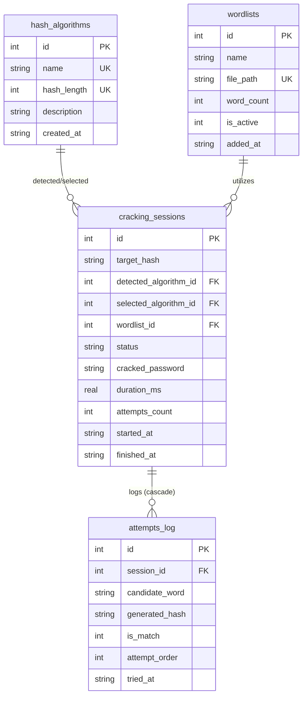

# Database Subsystem — Hash Cracker

**Author:** Rashad Sameh  
**Component:** `Database/`  
**Storage Engine:** SQLite 3  

---

## 1. Overview

The **Database Subsystem** provides persistent storage, analytical tracking, and audit logging for the **Hash Cracker** tool. It records every cracking session, tracks the selected cryptographic algorithms, logs individual password dictionary candidate attempts, and generates statistics for the web interface and reporting API.

---

## 2. Entity-Relationship Diagram



---

## 3. Schema & Tables

Defined in [`Database/schema.sql`](schema.sql):

| Table | Description |
|---|---|
| `hash_algorithms` | Pre-populated registry of supported hash functions (`MD5`, `SHA-1`, `SHA-256`, `SHA-512`). |
| `wordlists` | Metadata registry for loaded wordlist files and dictionary sizes. |
| `cracking_sessions` | Stores target hashes, status progression, cracked plaintext, duration, and metrics. |
| `attempts_log` | High-resolution attempt log for candidate passwords tested during an attack. |
| `v_session_summary` | SQL view aggregating sessions with algorithm names and wordlist details for quick reporting. |

---

## 4. API Reference (`DBManager`)

Implemented in [`Database/db_manager.py`](db_manager.py):

### Initializing & Context Management
```python
from Database.db_manager import DBManager

# Standard context manager pattern
with DBManager() as db:
    algos = db.get_all_algorithms()
```

### Algorithm Operations
- `get_algorithm_by_length(length: int)`: Resolves candidate algorithm by hex digest length (e.g. 32 -> MD5).
- `get_algorithm_by_name(name: str)`: Fetches algorithm by name (case-insensitive).
- `get_all_algorithms()`: Returns all supported algorithm records.

### Session Lifecycle
- `create_session(target_hash: str) -> int`: Creates a session in `pending` state.
- `set_algorithm(session_id, detected_algorithm_id, selected_algorithm_id=None)`: Binds detected and chosen algorithms.
- `start_running(session_id, wordlist_id)`: Marks the session as `running`.
- `mark_found(session_id, password, attempts_count, duration_ms)`: Marks session `found`.
- `mark_not_found(session_id, attempts_count, duration_ms)`: Marks session `not_found`.
- `mark_invalid_hash(session_id)`: Marks session `invalid_hash`.
- `mark_unsupported_algorithm(session_id)`: Marks session `unsupported_algorithm`.
- `mark_wordlist_not_found(session_id)`: Marks session `wordlist_not_found`.

### Candidate Attempt Logging
- `log_attempt(session_id, candidate_word, generated_hash, is_match, attempt_order)`: Log a single candidate trial.
- `log_attempts_batch(session_id, attempts)`: High-performance batch insertion using `executemany` for large wordlists.

### Frontend & API Contract Helpers
- `get_history(limit=50, offset=0)`: Formatted specifically for `GET /api/history` matching `API_CONTRACT.md`.
- `get_dashboard_stats()`: Provides `total_jobs`, `total_found`, and `success_rate` for `dashboard.html`.
- `get_reports()`: Provides aggregate report summaries for `GET /api/reports`.

---

## 5. Integration Example with `Core/dictionary_attack.py`

```python
from Database.db_manager import DBManager

with DBManager() as db:
    # 1. Create session
    session_id = db.create_session(target_hash)

    # 2. Bind algorithm & wordlist
    algo = db.get_algorithm_by_name("MD5")
    w_id = db.add_wordlist("Sample List", "passwords.txt", 100)
    db.set_algorithm(session_id, detected_algorithm_id=algo["id"])
    db.start_running(session_id, wordlist_id=w_id)

    # 3. Perform attack loop and log batch attempts
    # ...
    db.mark_found(session_id, password="password123", attempts_count=42, duration_ms=13.4)
```

---

## 6. Running Unit Tests

To run the automated test suite:

```bash
python3 -m unittest Database/test_db_manager.py
```
